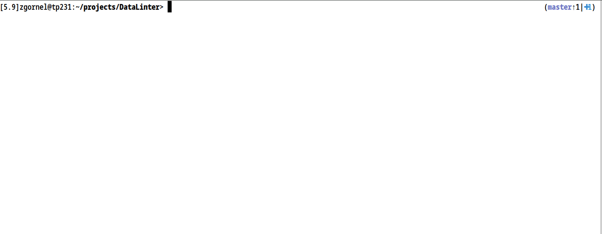

# `DataLinter`

Linter libraries and tools for ML/AI engineering.

[](LICENSE.md)
[](https://github.com/zgornel/DataLinter/releases/latest)
[](https://github.com/zgornel/DataLinter/actions/workflows/ci.yml?query=branch%3Amaster)
[](https://github.com/zgornel/DataLinter/actions/workflows/test.yml?query=branch%3Amaster)
[](https://codecov.io/gh/zgornel/DataLinter)
[](https://zgornel.github.io/DataLinter/dev)
[](https://github.com/fredrikekre/Runic.jl)
[](https://ghcr.io/zgornel/datalinter-compiled)



## Table of Contents
- [Introduction](#introduction)
- [Quick Start](#quick-start)
- [Installation](#installation)
- [Configuration](#configuration)
- [Integrations](#integrations)
- [Lint Catalog](#lint-catalog)
- [License](#license)
- [Contributing](#contributing)
- [References](#references)
- [Acknowledgements](#acknowledgements)

## Introduction

> “A runtime anti-pattern is a problem in software design that manifests statistically, function of the program complexity. This does not imply the stopping or halting of the program, only the altering of correct or expected functioning.”

**DataLinter** is a linter for data and code analysis. The aim is to address explicitly design issues that arise in ML/AI engineering. A distinct feature is that the linter supports simultaneous processing of multiple types of data: datasets, computer code etc. This is a more powerful approach for surfacing complex conceptual program design issues. The latter occur frequently in semantically rich workflows, such as in data science and ML/AI engineering.

**DataLinter** is written in Julia. It partially mimics and significantly extends the functionality the original Google [work](https://github.com/brain-research/data-linter).


### Features

- [High-level](https://github.com/zgornel/ParSitter.jl) code querying and pattern-matching, built on top of [tree-sitter](https://tree-sitter.github.io/tree-sitter/) parsers
- Supported languages and libraries: **R** (glm), **Python** (scikit)
- 27 [linters](https://zgornel.github.io/DataLinter/dev/linters_config/) for data, code that target runtime anti-patterns and include the original Google linters.
- Linters are [configurable](https://zgornel.github.io/DataLinter/dev): can be enabled or disabled and some expose working parameters.
- [CSV](https://github.com/JuliaData/CSV.jl)/[Parquet](https://parquet.apache.org/)/[Arrow](https://arrow.apache.org/) dataset support
- Text / JSON / HTML output support
- Docker image with compiled x86-64 binaries; CI/CD and production ready
- CLI and HTTP server modes

### Integrations
- [RStudio](https://github.com/zgornel/Rstudio-Addin-DataLinter)
- [VSCode](https://marketplace.visualstudio.com/items?itemName=OxoaResearch.vscode-extension-datalinter-r)
- [Jupyter Notebooks](https://github.com/zgornel/Ipython-datalinter)
- [Github Actions](https://github.com/OxoaResearch/datalinter-github-action)
- [Gitlab CI](https://github.com/OxoaResearch/datalinter-gitlab-ci)

## Quick Start

To run DataLinter:
 - pull the Docker image (see [installation](#installation))
 - `git clone` this repository
 - `cd` to repository root directory and run:
```bash
# Lint a dataset + modelling code for runtime anti-patterns
./datalinter ./test/data/imbalanced_data.csv \
    --code-path ./test/code/r_snippet_imbalanced.r \
    --config-path ./config/r_modelling_config.toml \
    --log-level error

# Or run the server for HTTP API use
./datalinterserver \
    -p 10000 \
    --config-path ./config/r_modelling_config.toml \
    --log-level debug
```

## Installation

### Docker image

The latest Docker image can be downloaded with
```bash
docker pull ghcr.io/zgornel/datalinter-compiled:latest
```
Specific versions are also tagged and **accessible** with (example for `v0.1.5`)
```bash
docker pull ghcr.io/zgornel/datalinter-compiled:v0.1.5
```

### Pre-compiled binaries (Linux x86-64)
Download the latest `datalinter-compiled-latest-linux-x86-64.zip` from the [Releases](https://github.com/zgornel/DataLinter/releases) page. Contains both CLI and server binaries.

> Note: Windows and macOS users should use Docker or install via Julia.

### Julia

Installation can be performed also from the Julia REPL with
```julia
using Pkg; Pkg.add(url="https://github.com/zgornel/DataLinter")
```

## Configuration

Check out the [documentation](https://zgornel.github.io/DataLinter/dev) for information on configuring, running and integrating the linters. Enable only the checks relevant to the runtime anti-patterns you care about.

## Lint Catalog

**DataLinter** ships with **27 built-in linters** covering data-quality issues and modelling-assumption violations that commonly appear as runtime anti-patterns: imbalanced targets, multicollinearity, violated GLM assumptions, silent type/coercion problems, outliers that distort models, etc. Full descriptions are available [here](https://zgornel.github.io/DataLinter/dev/linters_config/).

## License

This code has an MIT license.

## Contributing

Please see [CONTRIBUTING.md](CONTRIBUTING.md) on how to contribute.

To report a bug or request a feature, please [file an issue](https://github.com/zgornel/DataLinter/issues/new).

Recent changes can be found in [CHANGELOG.md](CHANGELOG.md).

## References

[1] https://en.wikipedia.org/wiki/Lint_(software)

[2] N. Hynes, D. Sculley, M. Terry "The data linter: Lightweight, automated sanity checking for ml data sets", NIPS MLSys Workshop, 2017; [paper](http://learningsys.org/nips17/assets/papers/paper_19.pdf)

[3] The [data-linter](https://github.com/brain-research/data-linter) code repository

## Acknowledgements

The initial version of **DataLinter** was fully inspired by [this work](https://github.com/brain-research/data-linter) written by Google Brain research.
