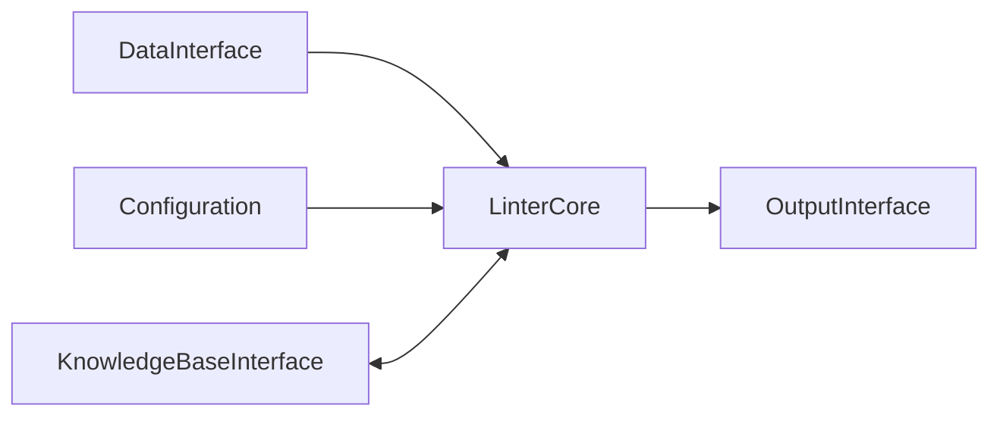

```@meta
CurrentModule=DataLinter
```

# Introduction

**DataLinter** is a linter for data and code analysis. The aim is to address explicitly design issues that arise in ML/AI engineering. A distinct feature is that the linter supports simultaneous processing of multiple types of data: datasets, computer code etc. This is a more powerful approach for surfacing complex conceptual program design issues. The latter occur frequently in semantically rich workflows, such as in data science and ML/AI engineering.

**DataLinter** is written in Julia. It partially mimics and significantly extends the functionality the original Google [work](https://github.com/brain-research/data-linter).

## Linting
The linter processes multiple data types for additional context. This supports the detection of more complex issues, such as those linked to interactions of semantically rich code and data. In machine learning for example, such interactions can generate ML models, code, datasets and new interactions. The rate of errors in each of these is dependent on input data properties, the algorithmic and input parameter choices as well as a good understanding of these from the part of the coder.

The *context* is additional information useful to linting data, available at compile or run time. For example, the classical way of linting a dataset is without any prior information on what the data will be used for. Hence, the assumptions about what the data will be used for are implicit. Context in this case could be the type of analysis or modelling the data is used for i.e. classification or, the code in a given programming language which uses the data. This provides a much higher degree of flexibility in the types of checks that can be implemented.

## Features

- [High-level](https://github.com/zgornel/ParSitter.jl) code querying and pattern-matching, built on top of [tree-sitter](https://tree-sitter.github.io/tree-sitter/) parsers
- Supported languages and libraries: **R** (glm), **Python** (scikit)
- 27 [linters](https://zgornel.github.io/DataLinter/dev/linters_config/) for data, code that target runtime anti-patterns and include the original Google linters.
- Linters are [configurable](https://zgornel.github.io/DataLinter/dev): can be enabled or disabled and some expose working parameters.
- [CSV](https://github.com/JuliaData/CSV.jl)/[Parquet](https://parquet.apache.org/)/[Arrow](https://arrow.apache.org/) dataset support
- Text / JSON / HTML output support
- Docker image with compiled x86-64 binaries; CI/CD and production ready
- CLI and HTTP server modes

## Installation

There are several ways to install DataLinter:
 - pulling a Docker image from the [Github container registry](https://ghcr.io) (quick & safe)
 - downloading binaries (Linux only)
 - cloning the Github repository (for development of the library)

### Docker image

The latest Docker image can be downloaded with
```bash
docker pull ghcr.io/zgornel/datalinter-compiled:latest`
```

For specific versions, use
```bash
docker pull ghcr.io/zgornel/datalinter-compiled:v0.x.y`
```

Available packages (Docker images) can be viewed in the ['Packages'](https://github.com/users/zgornel/packages?repo_name=DataLinter) section of the repository's Github page.

### Binaries

The cli and server binaries (linux-x86-64) can be downloaded from the [releases](https://github.com/zgornel/DataLinter/releases) page. Each release contains an  *Assets* section with the binaries as `datalinter-compiled-latest-linux-x86-64.zip`.


### Julia

Installation can be performed also from the Julia REPL with
```julia
using Pkg; Pkg.add(url="https://github.com/zgornel/DataLinter")
```

The repository can also be directly cloned with
```bash
git clone https://github.com/zgornel/DataLinter
```


## Architecture

 - The linter follows a [micro-kernel](https://en.wikipedia.org/wiki/List_of_software_architecture_styles_and_patterns#List_of_software_architecture_styles) architecture pattern. It is made out of a `Core` system - control flow and abstractions - and `plugins`, which provide input/output processing and linting functionality. In the architectural diagram below, arrows indicate **dependencies**:
```mermaid
graph LR
   A1[<b>CSV</b> plugin] --> DI[DataInterface]
   DI --> C[Core System]
   A2[<b>Parquet</b> plugin] --> DI
   A3[<b>Arrow</b> plugin] --> DI
   A4[<b>GenericDict</b> plugin] --> DI
   KN[<b>KnowledgeBaseNative</b> plugin] --> KI[KnowledgeBaseInterface]
   KN --> J[linters code (julia)]
   KI --> C
   O1[<b>Text</b> plugin] --> OI[OutputInterface]
   OI --> C
   O2[<b>JSON</b> plugin] --> OI
   O3[<b>HTML</b> plugin] --> OI
```

 - The `Core` system follows a [pipes & filters](https://en.wikipedia.org/wiki/List_of_software_architecture_styles_and_patterns#List_of_software_architecture_styles) architecture pattern. In the diagram below, arrows indicate **data flow**:


The modules and corresponding implementations are shown below:
- [`LinterCore`](https://github.com/zgornel/DataLinter/blob/master/src/linter.jl)
- [`Configuration`](https://github.com/zgornel/DataLinter/blob/master/src/config.jl)
- [`DataInterface`](https://github.com/zgornel/DataLinter/blob/master/src/data.jl)
- [`CSV` plugin](https://github.com/zgornel/DataLinter/blob/master/src/plugins/data/csv.jl)
- [`Parquet` plugin](https://github.com/zgornel/DataLinter/blob/master/src/plugins/data/parquet.jl)
- [`Arrow` plugin](https://github.com/zgornel/DataLinter/blob/master/src/plugins/data/arrow.jl)
- [`GenericDict` plugin](https://github.com/zgornel/DataLinter/blob/master/src/plugins/data/dict.jl)
- [`KnowledgeBaseInterface`](https://github.com/zgornel/DataLinter/blob/master/src/kb.jl)
- [`KnowledgeBaseNative` plugin](https://github.com/zgornel/DataLinter/blob/master/src/plugins/kb/native.jl)
- [`OutputInterface`](https://github.com/zgornel/DataLinter/blob/master/src/output.jl)
- [`Text` plugin](https://github.com/zgornel/DataLinter/blob/master/src/plugins/output/text.jl)
- [`JSON` plugin](https://github.com/zgornel/DataLinter/blob/master/src/plugins/output/json.jl)
- [`HTML` plugin](https://github.com/zgornel/DataLinter/blob/master/src/plugins/output/html.jl)
- [`Linters code (julia)`](https://github.com/zgornel/DataLinter/blob/master/knowledge/native)
